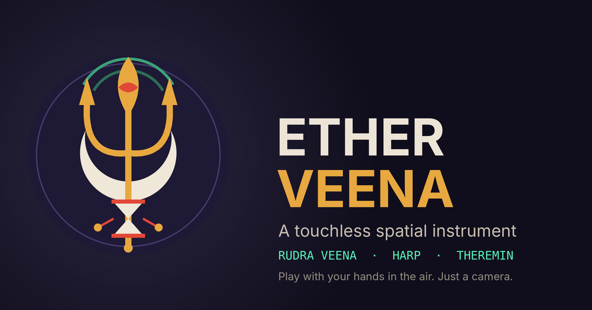

# ETHER VEENA

**A touchless spatial instrument.** Play a Rudra Veena, a harp or a theremin with your hands in the air — all you need is a camera and a browser. No install, no account, no extra hardware.

**▶ Try it: https://egoaid.github.io/ETHER-VEENA/**

Your camera follows your hands (and, if you like, your face). Where your hands are decides what you hear. Everything is processed on your own device: video is never recorded, saved or sent anywhere.

## Getting started

1. Open the app and press **Start**, then allow camera access.
2. Hold both hands up in a comfortable position and press **Calibrate**. A short countdown gives you time to get ready.
3. Play. Small movements are enough.

On the **theremin**, the right hand moves left and right for pitch, and the left hand moves up and down for volume. Press **Calibrate** again whenever your position changes.

## Instruments

- **Theremin** — continuous pitch, or helpers that pull you toward a scale (Chromatic, Snap Scale, Filter Scale, Easy Scale; thirty scales). Fine pitch by pinching, automatic vibrato when your hand trembles gently.
- **Rudra Veena** — four main strings with 24 frets, plus the chikari. The left index finger slides along the neck; curl it to bend the string (meend). The right hand plucks: bend a finger over a string. Ragas and traditional tunings are built in, with an optional drone.
- **Harp** — 47 strings (steel, gut or nylon). Sweep an open hand across them.

## Make it yours

- **Presets** — one tap sets everything: instrument, scale, hand mapping, sound, effects and look. There are presets for each instrument, including Rudra Veena ragas for different times of day. Save your own presets and export or import them as a file.
- **Mapping** — every finger, hand distance and face movement (mouth, smile, head turn) can control a sound parameter such as brightness, delay, reverb, pan or vibrato.
- **Synth and Effects** — waveform, second oscillator, filter, envelope, LFO, delay (normal or ping-pong), reverb and pan.
- **Randomize** — a new sound or look in one press. Lock the parts you want to keep: root note, scale, waveform, camera filter, colours and more.
- **Performance** — full screen with a few corner buttons. Point with your index finger and hold to press, so you never have to touch the screen.

## The look

Pick a **Camera filter** (Facets, Crystal, Relief 3D, Shards) to redraw the picture from polygons, so you stay unrecognisable — turn on **Privacy mode** to make sure Randomize and presets never switch it off. Add colour, a JPEG-style glitch, a CRT monitor look, a sound-reactive mandala background or your own image.

## Vector Camera

Take a photo of the polygon picture with a self-timer and optional burst of up to five shots. The file contains only the polygons — no buttons, no glitch, no CRT — so it stays sharp at any size. Save it as **SVG**, **PDF** or **PNG** (filled, coloured lines or black line art, with the background you choose), or share it straight from your phone's share sheet. In full screen use the **Photo** button.

## On a phone

- Works with the front or rear camera; a switch button appears when your phone has more than one.
- The screen stays awake while you play (on browsers that support it).
- Add it to your home screen from the browser menu ("Add to Home Screen" / "Install app") to open it like an app. A small note appears next to the version number when a newer version is available.

## Good to know

- Use a recent browser such as Chrome, Edge or Safari, in a well-lit room with your hands in view.
- Hand and face tracking models are downloaded the first time you start the camera, so you need to be online then.
- Your presets and settings stay in your browser on your device.

## Copyright

© 2026 egoaid. All rights reserved.

## Display performance
The Display section has a "Display performance" setting (Auto / Full / Lite / Minimal). Auto starts lighter on small phones and lowers the visual load by itself if the picture gets slow.

## If the sound stutters
The Display section also has a **Sound engine** setting. *Standard* is the full sound and is the default. If notes stutter or drop out on an older phone, choose *Light*: it plays the same instruments with fewer oscillators per note, shorter tails and a shorter reverb, and at most 8 notes at once. If the phone pauses the sound (a call, the lock screen), ETHER VEENA resumes it by itself; if the phone refuses, tap the screen once.
